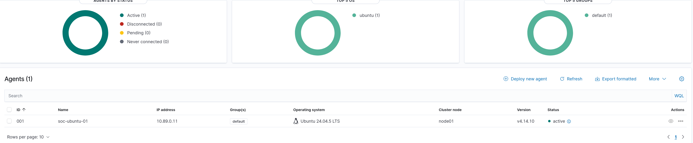
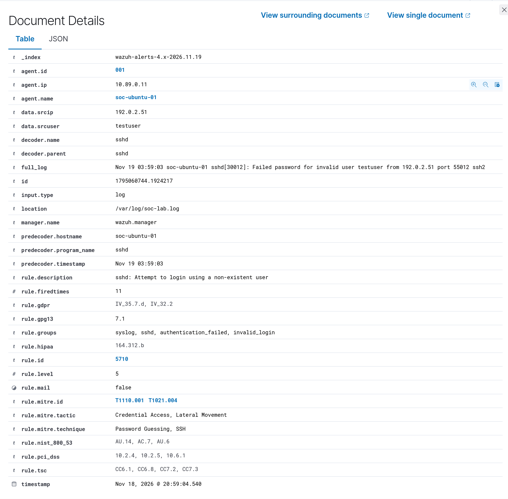
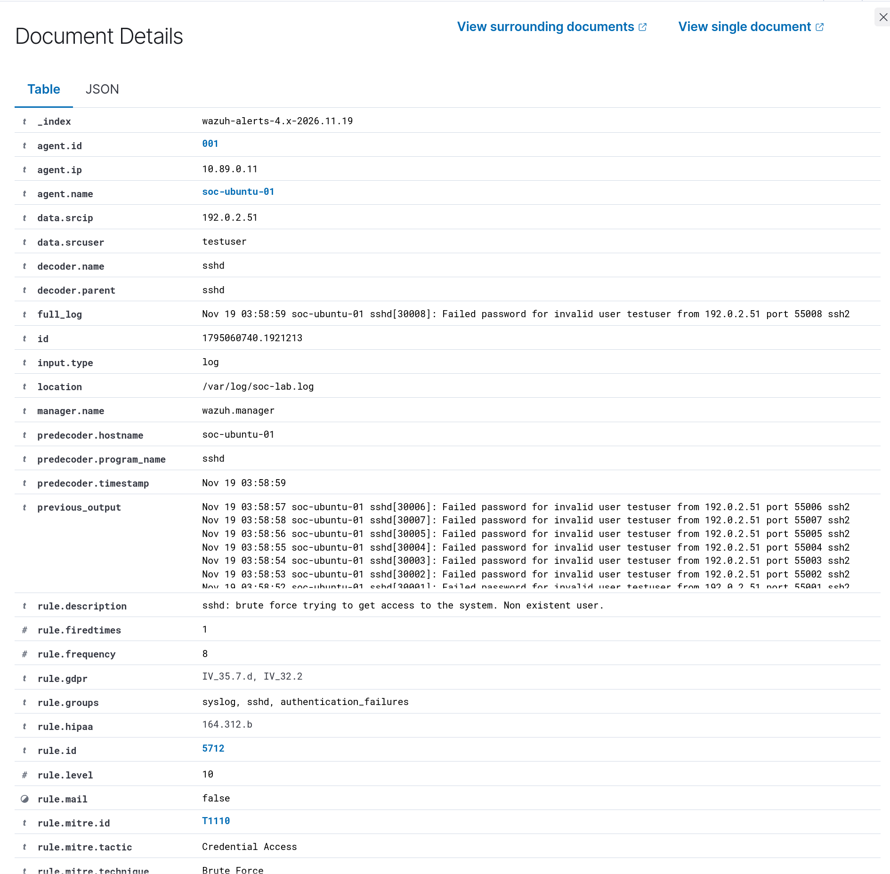
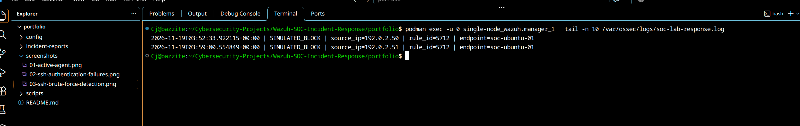

# Wazuh SOC Alert Triage & Incident Response Lab

**A hands-on cybersecurity portfolio project demonstrating security monitoring, SSH brute-force detection, incident investigation, and automated simulated incident response using Wazuh SIEM.**

## Project Overview

This project demonstrates the deployment and configuration of a Wazuh Security Information and Event Management (SIEM) environment to monitor a Linux endpoint, investigate suspicious authentication activity, and automatically execute a custom Python response script.

The lab was built using rootless Podman on Bazzite Linux, with Wazuh 4.14.10 and a monitored Ubuntu 24.04 container.

A controlled SSH brute-force simulation was performed by injecting synthetic authentication failures into a monitored log file.

Wazuh successfully correlated repeated authentication failures, generated a Level 10 security alert, and automatically executed a Python script to record a simulated containment action.

**All attack activity and containment actions were simulated. No real SSH attack or firewall blocking occurred.**

## Technologies Used

| Technology | Purpose |
|---|---|
| Wazuh 4.14.10 | SIEM, alert correlation, and active response |
| Ubuntu 24.04 | Monitored Linux endpoint |
| Bazzite Linux | Host operating system |
| Rootless Podman | Container deployment and networking |
| Python 3 | Custom automated response |
| Linux authentication logs | Simulated security event source |
| Git and GitHub | Version control and project documentation |

## Lab Architecture

The lab consists of a containerized Wazuh deployment and a monitored Ubuntu endpoint.

**Event processing workflow:**

1. Synthetic SSH authentication failures are written to `/var/log/soc-lab.log`.
2. The Wazuh agent collects the log events.
3. The Wazuh Manager analyzes and correlates the events.
4. Wazuh Rule 5712 generates a Level 10 brute-force alert.
5. The configured active response automatically executes a custom Python script.
6. The script records a simulated containment action for investigation and validation.

The Wazuh Dashboard provides visibility into the resulting alerts.

## Detection Rules

### Rule 5710 — Invalid SSH User

- Severity: Level 5
- Detection: Failed SSH authentication involving a nonexistent user
- Purpose: Identify individual suspicious authentication attempts

### Rule 5712 — SSH Brute Force

- Severity: Level 10
- Detection: Correlated SSH authentication failures
- Purpose: Identify repeated failed login attempts consistent with brute-force activity

## MITRE ATT&CK Mapping

| Technique | Description |
|---|---|
| T1110 — Brute Force | Repeated authentication attempts |
| T1110.001 — Password Guessing | Simulated SSH password-guessing behavior |

These techniques describe the simulated activity rather than a confirmed real-world compromise.

## Investigation Evidence

The following screenshots document the complete detection-to-response workflow in the Wazuh SOC lab.

### 1. Monitored Endpoint — Active Agent

The Ubuntu 24.04 endpoint successfully enrolled with the Wazuh Manager and established an active connection.

*Wazuh agent 001, soc-ubuntu-01, reporting Active status.*

### 2. SSH Authentication Failure Detection — Rule 5710

Wazuh detected individual failed SSH authentication attempts involving a nonexistent user.

*Rule 5710, Level 5, identifying failed authentication attempts from the simulated source IP.*

### 3. SSH Brute-Force Detection — Rule 5712

Repeated authentication failures triggered Wazuh's correlated brute-force detection rule.

*Rule 5712, Level 10, with MITRE ATT&CK mapping T1110 — Brute Force.*

### 4. Automated Simulated Response

The custom Python active response executed following the Rule 5712 alerts and recorded two simulated containment actions.

*Response log showing two successful script executions, including the source IP, triggering rule, timestamp, and affected endpoint.*

### Evidence Summary

| Stage | Result |
|---|---|
| Endpoint enrollment | Successful |
| Authentication monitoring | Verified |
| Brute-force detection | Rule 5712 triggered |
| Alert severity | Level 10 |
| Custom Python response | Executed automatically |
| Response logging | Two executions verified |

**Note:** The response was simulated. No actual firewall modification, IP blocking, or network containment was performed.